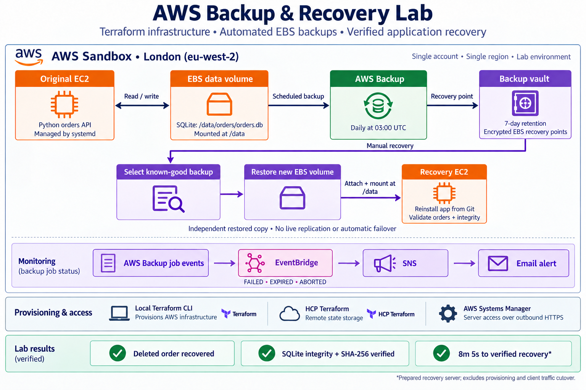
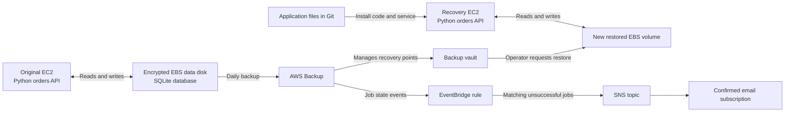

# AWS Backup and Recovery Lab with Terraform

A practical recovery lab for a small orders application running on
Amazon EC2, with SQLite data stored on a separate encrypted EBS volume.

The project demonstrates scheduled backups, backup-failure alerts,
recovery after accidental deletion, and application operation while
the original server is stopped. All orders are synthetic.

Infrastructure is managed with Terraform in an AWS Sandbox account,
using eu-west-2. Terraform executes locally, with state stored in
HCP Terraform.

## Recovery objectives

| Objective | Target |
|---|---|
| Recovery point objective (RPO) | No more than 24 hours of data loss |
| Recovery time objective (RTO) | Verified application recovery within 60 minutes |
| Backup schedule | Daily at 03:00 UTC |
| Backup retention | Seven days |

These are design targets. Successful scheduling alone does not guarantee
the RPO, and a completed backup job does not prove recoverability.

## Verified results

| Test | Observed result |
|---|---|
| Controlled on-demand backup | Completed with the application paused; encryption and seven-day retention verified |
| Scheduled backup | Completed on 13 October 2026 |
| Backup cancellation alert | A real ABORTED job produced an email through EventBridge and SNS |
| Restore to a separate server | Expected orders recovered; SQLite integrity passed and the database matched its baseline checksum |
| Controlled deletion recovery | Deleted Keyboard order recovered; verified application recovery took approximately 8 minutes 5 seconds |
| Post-backup data loss | A marker written after the selected backup was absent from the recovered database |
| Original server unavailable | Recovery application remained healthy after the original EC2 instance was stopped |
| Fresh-server preparation | Setup scripts installed the application on a fresh test server using an existing restored volume |
| Reboot verification | Restored disk mounted and application started automatically; expected orders and SQLite integrity verified |
| Temporary-server cleanup | Terraform removed the test server and attachment; root disk deletion and restored data-disk retention verified |

See [recorded test results](evidence/results.md) for timestamps,
resource identifiers and measurement boundaries.

The timed deletion exercise used an already-prepared recovery server.
Its approximately 8-minute-5-second result excluded server provisioning
and real client traffic switching.

At the incident, the selected recovery point was approximately
14 hours 32 minutes old, based on its recorded creation time.
One known later write was not recovered. Recovery-point age is not
proof of the exact last recoverable write.

The fresh-server setup test was completed on 14 October 2026.
It reused an existing restored disk and did not perform a new backup
restore. Its timings must not be presented as the timed deletion result.

## Scope and limitations

- This is a single-account, single-region learning lab.
- Recovery is operator-driven; automatic failover is not implemented.
- The recovered database is an independent copy, not a synchronised replica.
- The backup selection protects the original data volume, not EC2 root disks.
- Application code and the systemd service are installed separately from Git.
- Scheduled backups do not include an application-quiescing step.
- FAILED event matching was checked with a sample event; actual end-to-end
  alert delivery was verified using an ABORTED job.
- Missing or overdue backups are not covered by a dedicated monitoring check.
- The API listens on localhost; real client traffic cutover was not tested.
- Configuration and bootstrap policies contain lab-specific resource IDs.
  This repository is not an unchanged, one-command deployment into a new account.

## Project walkthrough

[View the illustrated PDF presentation](evidence/aws-backup-recovery-project-presentation.pdf)
for the complete walkthrough, including console screenshots, CLI evidence
and explanations of the recovery results.



The evidence folders contain [AWS job records](evidence/aws/),
[console screenshots](evidence/console/) and [CLI screenshots](evidence/cli/).
The screenshots retain the lab's account and resource identifiers.
These identify the environment, but do not provide credentials or access.

## Architecture



AWS Backup manages EBS snapshot recovery points through the backup vault.
Restoring a recovery point creates a new EBS volume. The operator attaches
it to a recovery server and verifies the filesystem, application and data.

The data disk is mounted at `/data`. The application accesses
`/data/orders/orders.db` through SQLite and serves a local HTTP API on
`127.0.0.1:8080`.

The EC2 instances use a public subnet and outbound HTTPS for Systems Manager.
The application security group has no inbound rules. Administration uses
Session Manager rather than inbound SSH.

Terraform runs locally with an assumed project role. HCP Terraform stores
the state. Separate bootstrap access manages the project role's permissions;
the project role does not grant itself additional permissions.

Dedicated EC2, backup and restore roles serve different purposes.
The backup and restore service roles use AWS-managed policies, which are
broader than the single resource selected for this exercise.

## Repository guide

| File or directory | Purpose |
|---|---|
| `versions.tf`, `.terraform.lock.hcl` | Terraform requirements, provider constraints and selected provider version |
| `provider.tf`, `identity.tf` | Region, allowed-account restriction, default tags and outputs |
| `network.tf`, `security.tf` | VPC, subnet, internet routing and security group |
| `compute.tf`, `storage.tf` | Original application server and separate data volume |
| `iam.tf` | EC2, backup and restore service roles and policy attachments |
| `backup.tf` | Backup vault, daily plan and explicit data-volume selection |
| `monitoring.tf` | SNS email subscription and EventBridge failure-event routing |
| `recovery.tf`, `variables.tf` | Recovery server and attachment to the selected restored volume |
| `bootstrap/` | Trust and permission-policy documents published separately through bootstrap access |
| `app/` | Python application, initial database creation script and systemd service |
| `tests/` | Sample backup events and an event pattern used to check matching behaviour |
| `recovery/` | Recovery instructions, setup scripts, restore metadata and temporary-server example |
| `terraform.tfvars.example` | Example local inputs; real values belong in ignored `terraform.tfvars` |
| `.gitattributes` | Preserves LF line endings for shell scripts |
| `myNotes.txt` | Chronological implementation notes and recorded test results |

## Recovery documentation

- [Recovery runbook](recovery/runbook.md): select a suitable backup,
  restore a volume, replace the prepared recovery server's attachment,
  and verify the recovered application.
- [Fresh-server setup](recovery/fresh-server-setup.md): transfer application
  files, identify and mount the restored disk, install the application,
  and verify startup after reboot.
- [Preparation script](recovery/prepare-server.sh): checks the mounted volume
  and database ownership, then prepares the application identity.
- [Installation script](recovery/install-application.sh): installs application
  code and the systemd service after preparation checks.
- [Temporary test-server example](recovery/setup-test.tf.example): reference
  configuration used to verify fresh-server setup. Review its resource IDs
  and intended changes before reuse.

`app/init_db.py` is for initial lab seeding only. Do not run it as part
of recovery.

Restored EBS volumes are created by AWS Backup outside this project's
Terraform state. Terraform manages their attachments; the volumes require
separate tracking and cleanup.

## Prerequisites and configuration

This project was developed using Windows PowerShell, AWS CLI v2,
Terraform 1.16.x and the AWS provider version recorded in
`.terraform.lock.hcl`.

The Linux application and recovery scripts target the project's
Amazon Linux 2023 configuration.

Working with the existing lab requires:

- Access to the intended AWS Sandbox account.
- A `backup-recovery` CLI profile that assumes the project Terraform role.
- Separate `sandbox-bootstrap` access for approved IAM administration.
- Access to the HCP Terraform organisation and workspace configured
  in `versions.tf`.
- HCP workspace execution mode set to Local.
- Local variable values for the alert email and existing restored volume.
- Confirmation of the SNS email subscription.

Use `terraform.tfvars.example` as a reference when preparing local inputs.
Do not overwrite an existing `terraform.tfvars` without reviewing it.

The restored volume ID must identify a real, verified volume in the
recovery server's Availability Zone. The variable validation checks
its format only.

The final configuration expects an existing restored volume.
Initial infrastructure creation, the first backup and the first restore
were separate stages during development.

Before adapting this project to another environment, review the account
restriction, HCP settings, AMI, resource IDs, encryption keys and bootstrap
policy resource ARNs. Several permissions are restricted to resources
created during this lab.

Bootstrap JSON files are permission documents, not automatically applied
Terraform resources. Editing them locally does not update AWS IAM.

## Routine Terraform checks

From the configured project directory, verify the active AWS identity:

```powershell
$env:AWS_PROFILE = "backup-recovery"
aws sts get-caller-identity --profile backup-recovery --output json
```

Confirm that the returned account and role are the intended lab identity.

Run these individually, stopping if a command fails:

```powershell
terraform fmt -check
terraform validate
terraform plan
```

Review the complete plan before applying any changes.
A successful plan does not prove application health or backup usability.

The EC2 resources ignore changes to `associate_public_ip_address` after
creation. This addresses the replacement plan observed after an instance
was stopped. Intentional changes to that setting require reviewing
the lifecycle exception.

## Cost controls

The lab was designed around a total budget below £20, with a spending
review at £12. These are operating limits, not an automated spending cap.

Cost controls used in the configuration and workflow include:

- Small EC2 instances with standard CPU credits.
- Small gp3 volumes.
- Seven-day backup retention.
- Removal of the temporary setup-test server after verification.
- Explicit tracking of restored volumes outside Terraform state.

Running instances, public IPv4 addresses, EBS storage and retained backups
can incur charges. Stopping an instance does not remove its EBS storage
charges. Detached restored disks also continue to incur storage charges.

Review actual billing during the exercise and verify remaining resources
after cleanup. This README does not certify a final project cost.

## Teardown approach

Full teardown is a separate, reviewed operation.

Before removing resources:

1. Save the required test evidence and commit the intended documentation.
2. Inventory Terraform-managed resources, restored volumes, recovery points
   and bootstrap IAM resources.
3. Agree which data and backups must be retained.
4. Review a Terraform destruction plan for the intended project scope.
5. Stop application writes and unmount data disks before detaching them.
6. Stop further scheduled backups and check for active backup or restore jobs
   before removing approved recovery points that are no longer needed.
7. Apply the reviewed infrastructure cleanup.
8. Handle approved restored-volume cleanup separately.
9. Remove project bootstrap permissions only after the operations that
   depend on them have finished.
10. Verify the remaining AWS resources and subsequent billing.

The backup vault has `force_destroy = false`. A non-empty vault cannot
be removed by simply destroying the Terraform configuration.

Restored volumes and separately managed bootstrap IAM resources are not
automatically removed by the main Terraform teardown.

Protect the AWS Organization, member accounts, John and unrelated resources.

## Verified teardown, 14 October 2026

The lab infrastructure has been removed:

- Removed the backup assignment and confirmed no unfinished backup or restore jobs.
- Deleted all three recovery points and emptied the backup vault.
- Terraform destroyed the remaining 27 managed resources.
- Verified empty Terraform state and both main EC2 servers terminated.
- Deleted both restored data volumes and confirmed no project-tagged EBS volumes remained.
- Confirmed the three known backup snapshots were absent and found no additional snapshots associated with the three data disks.
- Removed the project Terraform access role and its six unused policies.

John, bootstrap access, the AWS Organization and member accounts were preserved.
The code, recovery guides and portfolio evidence remain available.

Final billing review is outstanding. These checks confirm resource cleanup,
but do not certify a final cost or rule out charges from unrelated resources.
